<div align="center">

# 🩺 MyDoctor — Telemedicine Web Application

**A full-stack telemedicine platform where patients book doctors, chat in real time and join live video consultations, with an admin panel for verifying and moderating every user.**


[Features](#-features) · [Screenshots](#-screenshots) · [Architecture](#-architecture) · [Tech Stack](#-tech-stack) · [Setup](#-getting-started)

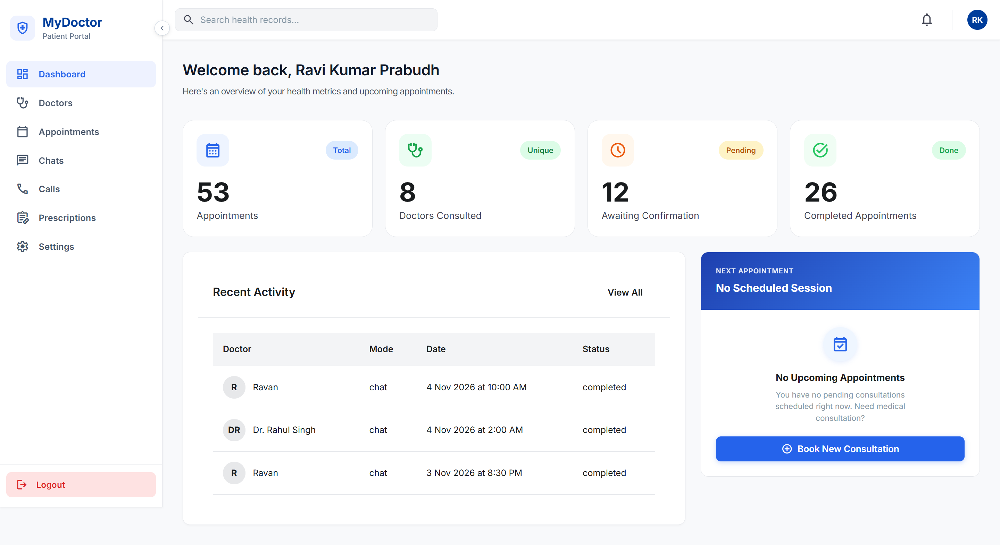

</div>

---

## 📌 Overview

MyDoctor is a role-based telemedicine system with **three separate panels** (Admin, Doctor and Patient), built from scratch in plain PHP and vanilla JavaScript **without any framework**.

It covers the full consultation lifecycle:

> **Patient books a slot → Doctor confirms → Chat opens near the slot time → Doctor starts a video/audio call → Consultation is completed with a prescription → Patient can book a follow-up.**

Meanwhile, the admin verifies doctor credentials, manages users, and blocks or unblocks accounts.

### Highlights

- 🎥 **Peer-to-peer video and audio calls** using **WebRTC**, with Firebase Realtime Database as the signaling channel
- 💬 **Real-time chat** tied to each appointment, with read receipts and unread counts
- 🗓️ **Slot-based scheduling**: weekly doctor availability, date exceptions, rescheduling and patient counter-proposals
- 🛡️ **Doctor verification workflow**: admin approves or rejects doctors, and the decision is audited and notified
- 🔐 **Server-side role-based access control** on every API endpoint
- 🧱 **Layered architecture** (Middleware → API → Service → Model) instead of SQL mixed into pages

---

## ✨ Features

### 👤 Patient
| Feature | Details |
|---|---|
| Find doctors | Search and filter verified doctors by specialization and fee, see profiles and availability |
| Book appointments | Choose a free slot, add the reason for the visit, choose chat or video consultation |
| Manage bookings | Cancel, accept a doctor's reschedule, or propose an alternate slot |
| Follow-ups | Book a follow-up visit from a completed consultation |
| Chat & calls | Real-time chat with the doctor; join video or audio calls from the browser |
| Prescriptions | View the prescriptions issued after completed consultations |
| Dashboard & settings | Upcoming visits, notifications, profile and photo management |

### 👨‍⚕️ Doctor
| Feature | Details |
|---|---|
| Dashboard | Today's appointments, pending requests, completed consultations and recent patient activity |
| Appointment workflow | Confirm, cancel, reschedule and complete appointments, with a prescription on completion |
| Availability | Weekly working hours with automatic slot generation that respects date-specific exceptions |
| Chat & calls | Start WebRTC video or audio calls with patients; call history with durations |
| Notifications | Live alerts for new bookings and changes |
| Settings | Professional profile, consultation fee and validated photo upload |

### 👨‍💼 Admin
| Feature | Details |
|---|---|
| Dashboard | Platform-wide statistics for doctors, patients and appointments |
| User verification | Review doctor credentials, **approve or reject with a reason**; the doctor is notified |
| Doctor & patient management | Searchable, paginated tables; add doctors directly |
| Appointments | Monitor all appointments across the platform |
| Blocked users | Block or unblock accounts, with a full audit log of who did what and when |

---

## 📸 Screenshots

### Patient Panel

| Dashboard | Find Doctors |
|---|---|
|  | 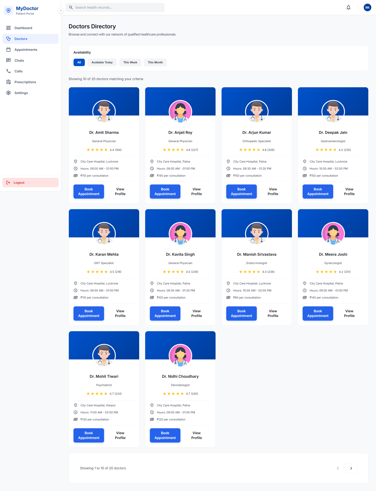 |
| **Appointments** | **Chats** |
| 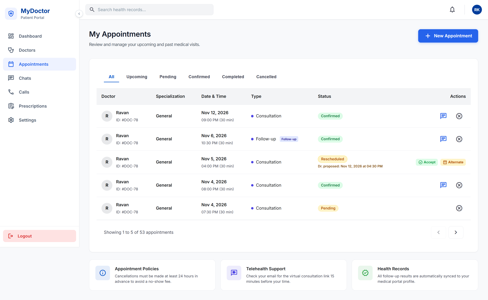 | 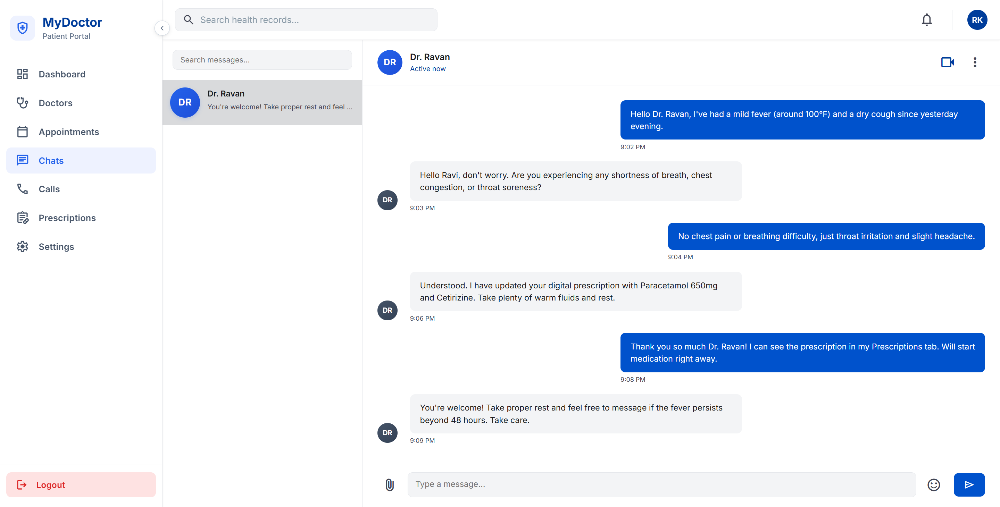 |
| **Calls** | **Prescriptions** |
| 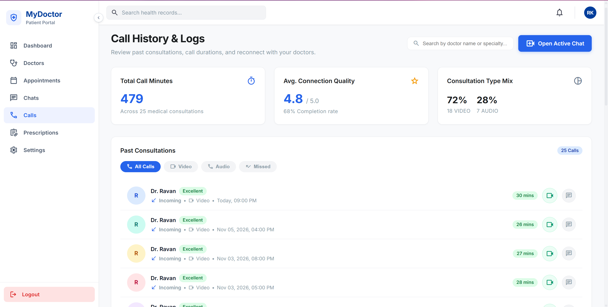 | 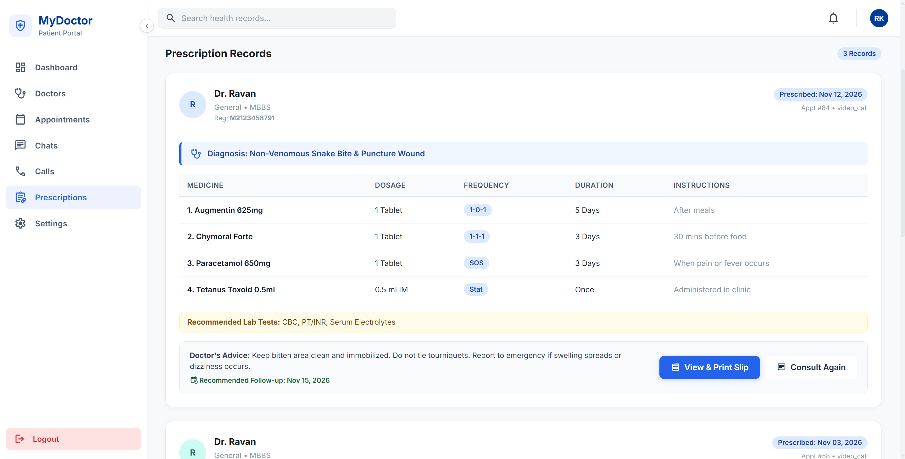 |

### Doctor Panel

| Dashboard | Appointments |
|---|---|
| 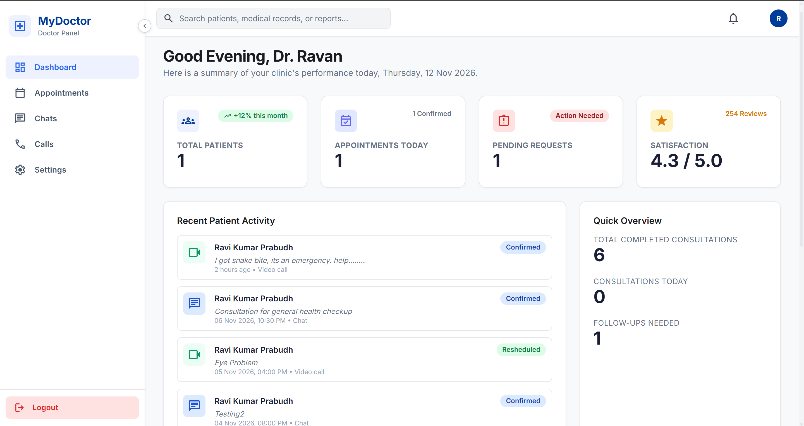 | 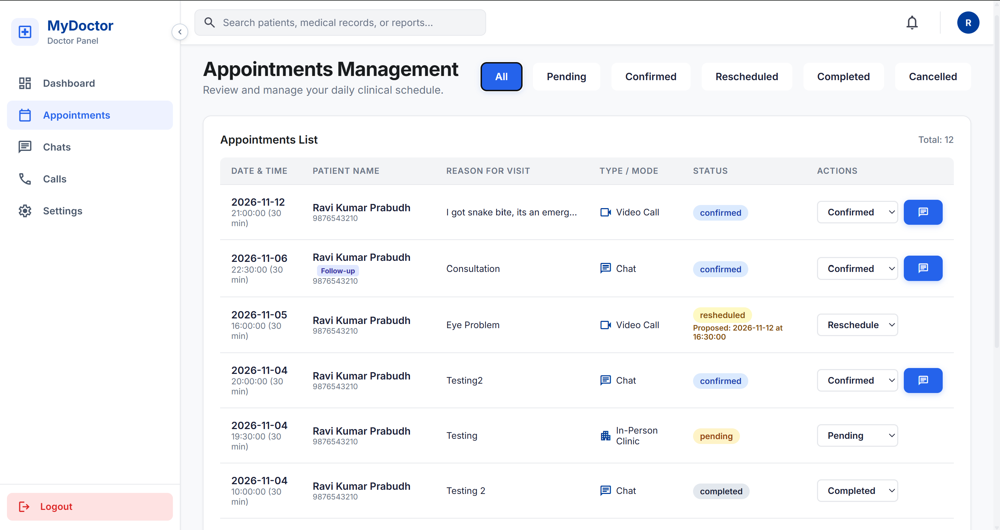 |
| **Chats** | **Calls** |
| 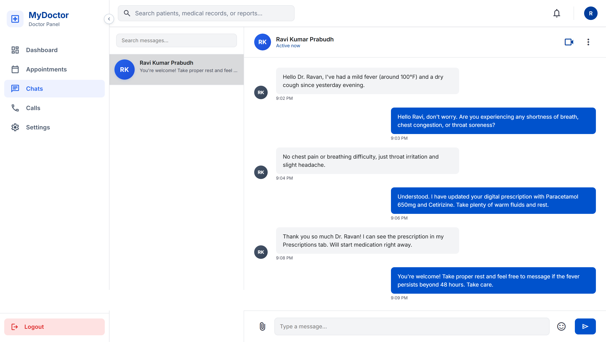 | 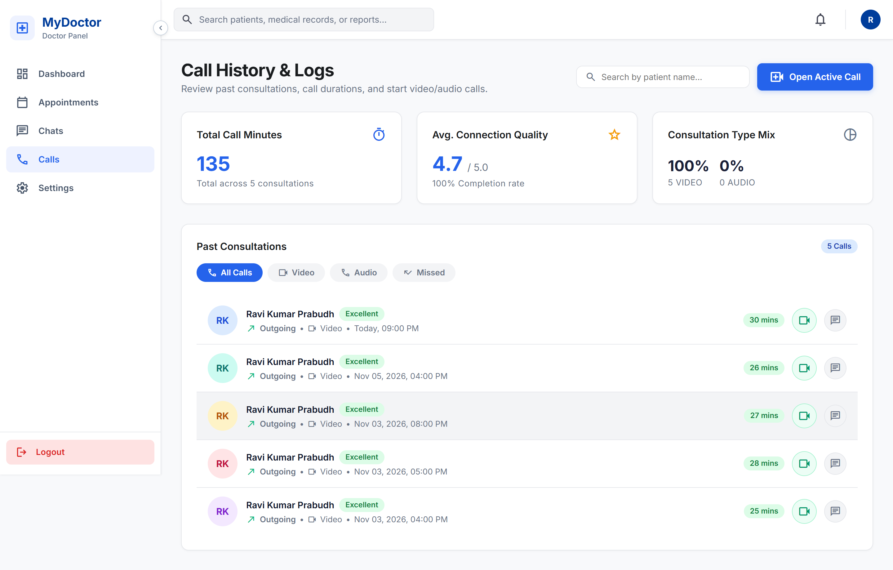 |

### Admin Panel

| Dashboard | User Verification |
|---|---|
| 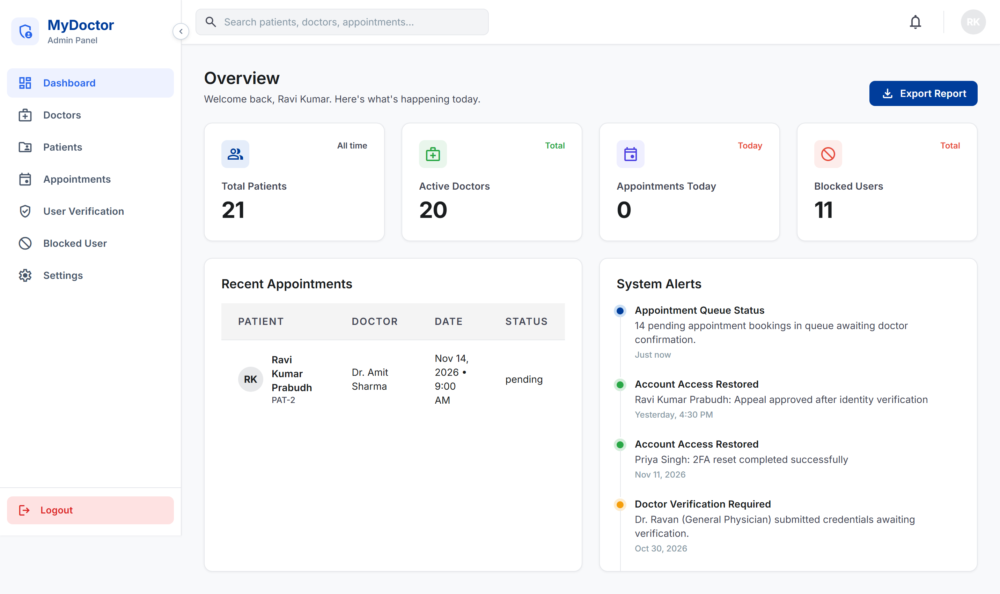 | 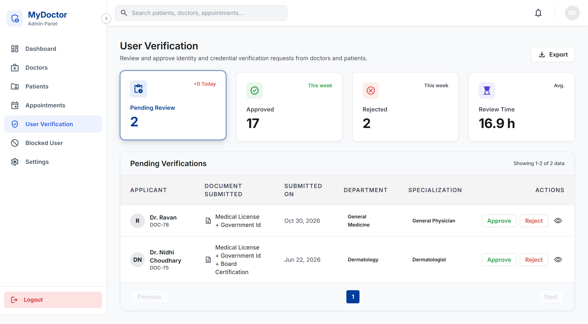 |
| **Doctors** | **Patients** |
| 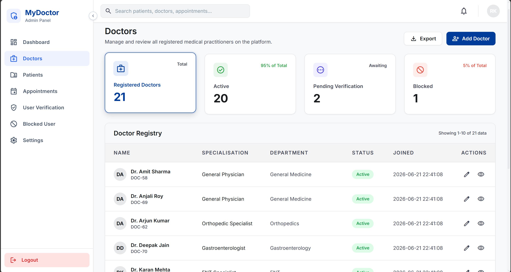 | 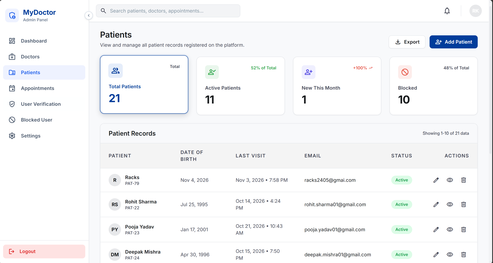 |
| **Appointments** | **Blocked Users** |
| 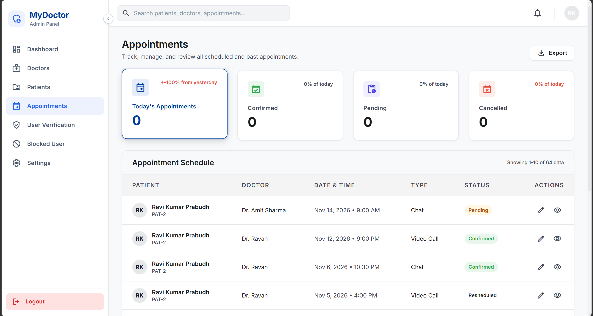 | 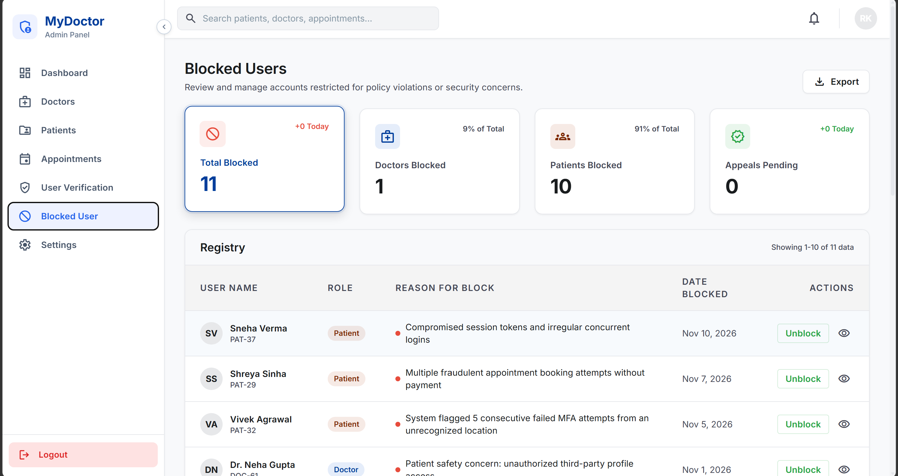 |

---

## 🏗️ Architecture

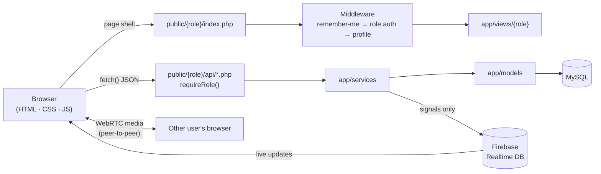

### How a request flows
1. **Page load:** `public/{role}/index.php` runs the middleware chain (remember-me auto-login → role check → profile loader), then renders the panel shell.
2. **SPA-style navigation:** the sidebar loads sections through `load-page.php?page=…` (a whitelisted page map) without a full reload.
3. **Data:** each section calls JSON endpoints in `public/{role}/api/`. Every endpoint first checks `requireRole('admin' | 'doctor' | 'patient')`, then delegates to a **Service** (business rules), which uses a **Model** (prepared SQL statements).
4. **Real time:** MySQL is the single source of truth. Firebase Realtime DB carries only lightweight signals (a new message, a dashboard refresh, call presence, WebRTC offers/answers/ICE candidates), and the server issues Firebase **custom tokens** to authenticate users.
5. **Calls:** the doctor's browser creates the WebRTC offer, the patient answers, and media flows **peer-to-peer** over STUN (TURN can be configured). Call start, end and duration are logged in MySQL.

### Project structure

```text
my_doctor/
├── app/
│   ├── helpers/        # auth (me, requireRole), JSON response, appointment time rules
│   ├── middleware/     # remember-me, role guards, profile loaders
│   ├── models/         # SQL layer: Appointment, Chat, Doctor, User
│   ├── services/       # business logic: admin/, doctor/, patient/, Chat, Notification
│   └── views/          # page templates per role
├── config/             # database, Firebase and WebRTC (ICE servers) config
├── database/
│   └── schema.sql      # full database schema (14 tables, no data)
├── docs/screenshots/   # README images
├── public/             # web root
│   ├── admin/ doctor/ patient/   # panel entry points + api/ endpoints
│   ├── api/            # shared chat and call endpoints, Firebase token
│   ├── assets/         # CSS and JS (call.js, firebase-client.js, per-role scripts)
│   ├── uploads/        # user uploads (script execution disabled)
│   ├── index.php       # login / register
│   └── login_register.php, logout.php
└── composer.json       # kreait/firebase-php
```

### Database (14 tables)
`users` · `doctors` · `appointments` · `doctor_availability` · `doctor_availability_exceptions` · `doctor_slots` · `conversations` · `messages` · `call_logs` · `prescriptions` · `notifications` · `verification_documents` · `blocked_logs` · `restriction_policies`

---

## 🔐 Security

- **Role-based access control on the server:** every API endpoint verifies the session's role (`requireRole()`), returning `401` or `403` otherwise; the client cannot override identity
- **Prepared statements** for all database queries (protection against SQL injection)
- **Password hashing** with `password_hash()` / `password_verify()` (bcrypt)
- **Session fixation protection:** the session ID is regenerated on login and on remember-me restore
- **Secure remember-me:** a random 256-bit token; only its **SHA-256 hash** is stored; cookies are `HttpOnly` and `SameSite=Lax` (and `Secure` over HTTPS); blocked users cannot sign in
- **No self-registration as admin:** only doctor and patient accounts can register
- **CSRF tokens** on chat and call endpoints
- **Safe uploads:** images are validated server-side, and `.htaccess` disables script execution in `uploads/`
- **Output escaping** of user-provided messages (XSS protection)
- **Audit trail:** verification decisions and block/unblock actions record the admin and timestamp
- **Secrets stay out of Git:** the Firebase service account and environment files are git-ignored

---

## 🛠️ Tech Stack

| Layer | Technologies |
|---|---|
| Frontend | HTML5, CSS3 (responsive, collapsible sidebar), Vanilla JavaScript (ES6, Fetch API) |
| Backend | PHP 8.2 (no framework), layered MVC-style architecture, JSON REST-style APIs |
| Database | MySQL / MariaDB (`mysqli`, prepared statements, transactions) |
| Real-time | Firebase Realtime Database (signaling and live updates), Firebase Custom Auth |
| Video/Audio | WebRTC (`RTCPeerConnection`, STUN/TURN) |
| Tooling | Composer (`kreait/firebase-php`), XAMPP (Apache), phpMyAdmin, Git |

---

## 🚀 Getting Started

### Prerequisites
- **XAMPP** (PHP 8.1+ with `mysqli`, Apache, MySQL/MariaDB)
- **Composer**
- A **Firebase project** with Realtime Database enabled (needed for chat and calls)

### 1. Clone into `htdocs`
```bash
cd C:/xampp/htdocs
git clone https://github.com/racks1401/mydoctor-telemedicine-web-app.git my_doctor
cd my_doctor
```
> Keep the folder name **`my_doctor`**: the app currently uses `/my_doctor/public/` as its base URL.

### 2. Install PHP dependencies
```bash
composer install
```

### 3. Create the database
1. Start **Apache** and **MySQL** from the XAMPP Control Panel.
2. Open `http://localhost/phpmyadmin` and create a database named **`my_doctor_db`** (collation `utf8mb4_general_ci`).
3. Import **`database/schema.sql`**.
4. Adjust the credentials in `config/database.php` if your MySQL user is not `root` with an empty password.

### 4. Configure Firebase
1. In the Firebase Console, open **Project settings → Service accounts → Generate new private key**.
2. Save the file as **`service-account.json`** in the project root (it is git-ignored, so never commit it).
3. Update the Realtime Database URL in `config/firebase.php`.

### 5. Create the first admin
Admins cannot self-register. Register any account from the UI, then promote it:
```sql
UPDATE users SET user_type = 'admin' WHERE email = 'you@example.com';
```

### 6. Run
Open **http://localhost/my_doctor/public/**, register a doctor and a patient, approve the doctor from the admin panel, and book your first consultation.

> **Video calls across devices:** browsers allow camera and microphone only on `localhost` or HTTPS. For calls between different networks, add a TURN server through the `WEBRTC_TURN_URLS`, `WEBRTC_TURN_USERNAME` and `WEBRTC_TURN_CREDENTIAL` environment variables.

---

## 🗺️ Roadmap

- [ ] CSRF protection on every state-changing endpoint
- [ ] Configurable base URL (remove the hard-coded `/my_doctor/` path)
- [ ] Password reset over email
- [ ] Ratings and reviews from completed consultations
- [ ] Online payments for consultation fees
- [ ] Email/SMS appointment reminders
- [ ] Docker setup and cloud deployment

---

## 📄 License

Released under the [MIT License](LICENSE).

## 👨‍💻 Author

**Ravi Kumar Prabudh**

[](https://github.com/racks1401)
[](https://portfolio-site-c4ceb.web.app/)

<div align="center">

⭐ If you found this project interesting, consider giving it a star!

</div>
